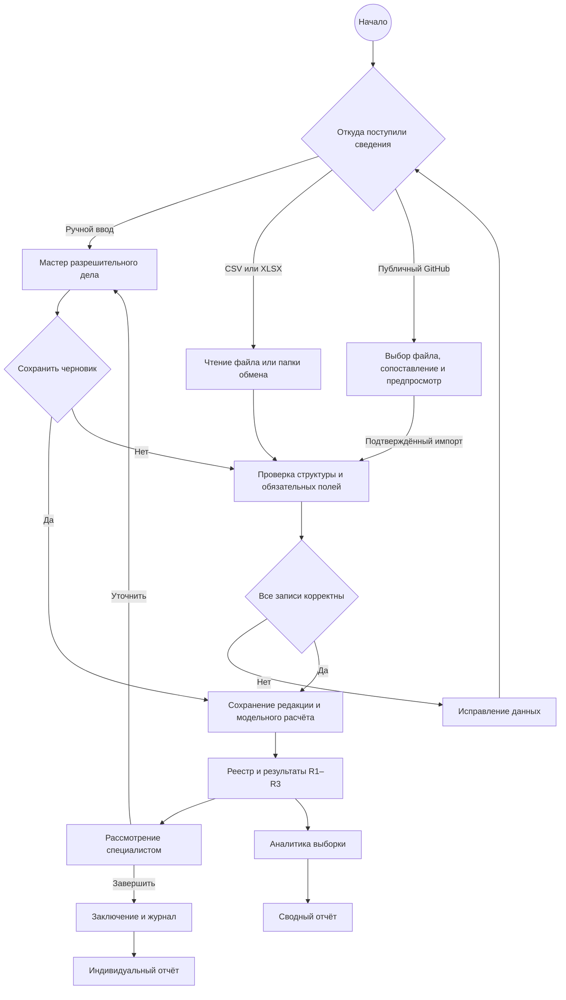
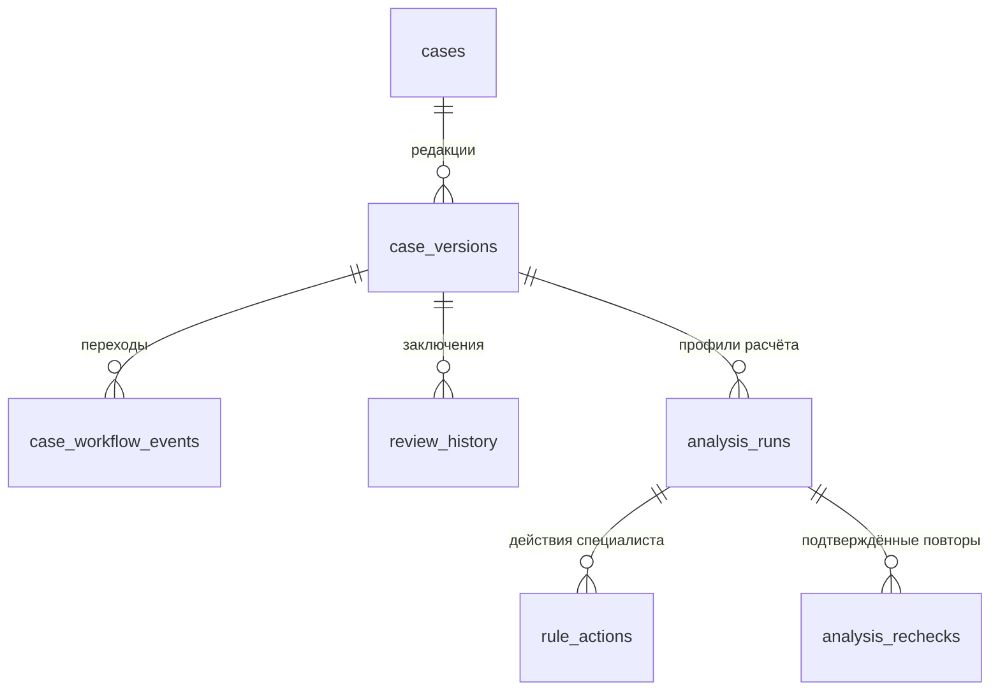

# Архитектура «Зелёного контроля»

`app.py` и `ui/` отображают интерфейс. `core/models.py` нормализует входные сведения, `core/rules.py` выполняет R1–R3, `core/guidance.py` строит рекомендации, `core/storage.py` ведёт ревизии. `core/analytics.py` агрегирует отфильтрованные дела, а `core/reports.py` формирует выгрузки. Профиль хранится отдельно в JSON.

## Диаграмма деятельности

## Схема SQLite

`cases` хранит текущий снимок, источник и рабочее состояние. Таблица `reviews` v1.4 сохраняется для совместимости. `schema_migrations` регистрирует выполненные миграции. Пакет импортируется одной транзакцией SQLite. Для GitHub таблица `github_imports` хранит репозиторий, путь, ветку или коммит, версию файла, SHA-256, время и результаты импорта. Метаданные и редакции фиксируются в одной транзакции. `core/presentation.py` отвечает за русские подписи и даты на экране и в документах. Три модельных результата привязаны к номеру дела, редакции, ID и версии профиля. Повторный расчёт сравнивается с сохранённым и добавляет отметку. Изменение версии карточки сохраняет исходный анализ и заключение в истории.

Генератор хранит эталонные метки в сценариях и может формировать CSV/XLSX без движка. Отдельный инструмент оценки запускает правила и сопоставляет результаты по техническим ID. Готовая SQLite с 200 делами находится в каталоге синтетики. Рабочая база и база демонстрации используют одну схему и разные файлы.
